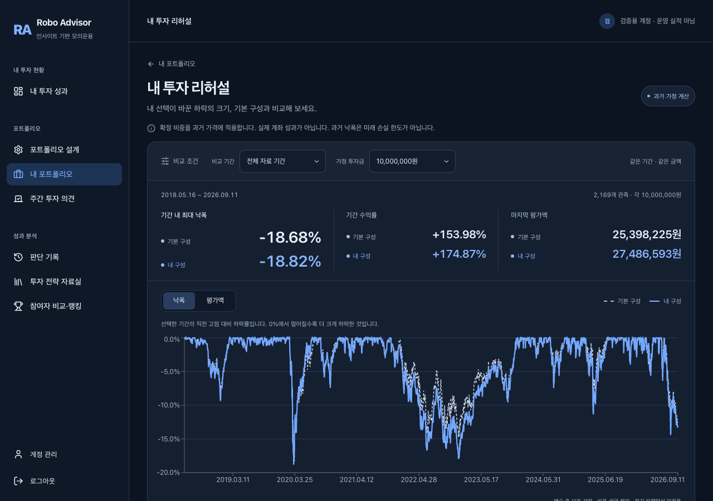

# 투자 리허설 V1 화면 개선

## 문제와 변경

기존 화면은 주의문, 구성별 카드, 평가액 그래프, 낙폭 그래프가 수직으로 이어져 두 구성의 차이와 다음 행동을 찾기 어려웠다. V1의 기능 범위 안에서 정보 순서와 상호작용을 정리했다.

- 비교 조건과 결과를 한 패널에 모으고, 지표마다 기본 구성과 내 구성을 같은 열에서 비교한다. 최대 낙폭을 먼저 보여준다.
- 낙폭을 기본 그래프로 두고 평가액은 버튼으로 전환한다. 전환은 추가 요청 없이 같은 API 응답을 사용한다. 기본 구성은 점선, 내 구성은 실선으로 구분한다.
- 그래프 바로 아래에 확정 당시 이유와 기존 판단 검토 링크를 배치한다. 자산 비중과 계산 기준은 각각 펼칠 수 있다.
- 과거 가정 계산이라는 안내를 항상 표시한다. 계산 방식·비용 제외·가격 자료의 한계는 상세에 보존한다.
- 모바일은 최대 낙폭 두 값을 나란히 표시하고, 조건 선택과 검토 버튼의 공간을 확보한다. 키보드 포커스와 선택 상태를 제공한다.

API, 금융 계산, 원래 판단, 운용 시작일, 주문, NAV, 스케줄은 변경하지 않았다. 두 구성의 차이가 투자자에게 유익한지에 관한 사용자 시험은 아직 수행하지 않았다.

## 검증

- 프런트 단위 테스트 134개 통과, 타입 검사 및 production 빌드 통과.
- 격리 SQLite와 실제 FastAPI, production Next.js를 사용하는 브라우저 테스트 2개 통과. 운영 DB에 쓰지 않는다.
- 기간·투자금 변경 결과를 실제 API 값과 대조하고, 그래프 전환 후 값 보존과 키보드 포커스를 확인했다.
- 로딩·실패·재시도 중 이전 조건의 결과가 새 조건에 붙지 않는지 확인했다.
- 1280×900 첫 화면에 그래프가 시작되는지, 390px·320px 화면에서 가로 넘침이 없는지 확인했다.
- 검토 화면 이동 전후 판단·주문·체결·NAV의 레코드 수와 최초 판단 내용이 유지되는지 확인했다.

재현: 저장소 루트에서 `.venv/bin/python web/e2e/run_rehearsal.py`. 이 실행기는 임시 DB와 로컬 서버를 만들고 종료한다. 아래 화면은 격리 검증 계정이며 운영 실적이 아니다.

## 화면 증거

- [전체 기간 데스크톱](evidence/investment-rehearsal-ux/all-period-desktop.png)
- [2022년 데스크톱](evidence/investment-rehearsal-ux/year-2022-desktop.png)
- [2022년 모바일·상세 펼침](evidence/investment-rehearsal-ux/year-2022-mobile.png)

화면과 조작 검증은 완료했지만 실제 투자자의 이해도·반복 사용 개선을 입증한 것은 아니다. 후속 사용자 시험에서는 두 구성의 낙폭 차이, 가정 계산과 운용 실적의 구분, 다음 검토 행동을 설명할 수 있는지 확인한다.
