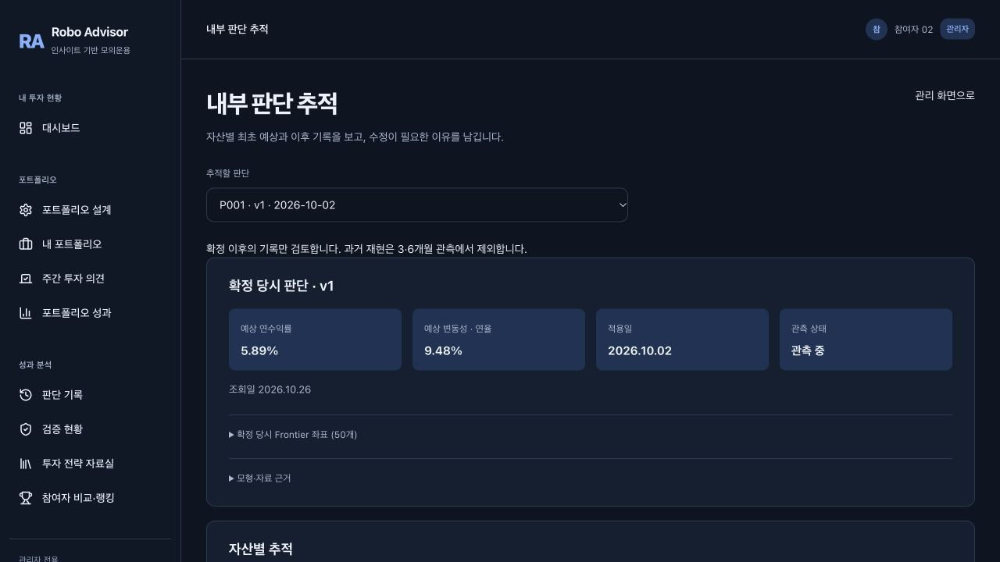
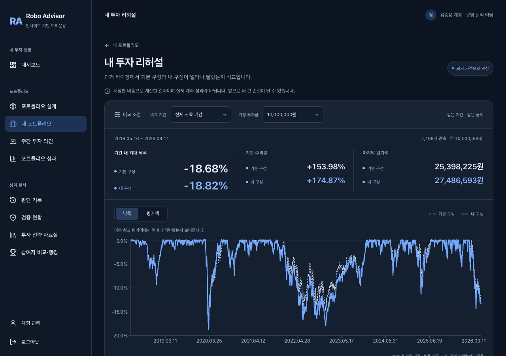
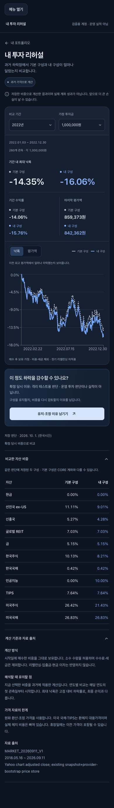

# 10월 26일 랩미팅: 구현 내용과 다음 검증

이 문서의 기능 설명과 테스트 캡처는 구현 근거다. 수익률 우위나 사용자 효용을 입증하는 자료는 아니다.

## 오늘 전달할 핵심

처음 선택한 구성과 그 이유를 보관하고, 이후 기록을 보고 유지·조정을 검토하는 흐름을 만들었다. 과거 가격 비교와 실제 모의운용 기록은 구분한다. 이번 주에는 기능을 더 늘리기보다, 이 화면으로 투자자가 판단을 더 잘 설명할 수 있는지 확인하려 한다.

## 화면을 보여줄 순서

| 순서 | 화면 | 보여줄 내용 | 아직 말할 수 없는 것 |
| --- | --- | --- | --- |
| 1 | 대시보드 → 전체 기록 | 10월 1일부터의 저장 NAV, 과거 재현/모의운용 경계, 내 계좌와 CORE | 10월 1일부터 매일 자동운용에 성공했다는 주장 |
| 2 | 내 포트폴리오 → Frontier 점 → 투자 판단 검증 | 확정 당시 예상 수익률·변동성·비중, 기본 구성 대비 예상 위험, 같은 기간 계좌 성과, 검토 일정 | 연간 예상과 며칠간의 수익률을 비교한 적중 판정 |
| 3 | 관리자 → 내부 판단 추적 | 자산별 최초 예상·관측 가격·계좌 수익 기여도, 3·6개월 일정, 검토 근거 저장 | 당시 저장하지 않은 자산별 예상값의 복원, 자동 모형 수정 |
| 4 | 내 포트폴리오 → 내 투자 리허설 | 같은 기간·금액의 기본 구성과 내 구성 비교, 최대 낙폭·최종 평가액, 유지·조정 이유 남기기 | 미래 최대 손실, 실제 계좌 성과, 비용 반영 우위 |

관리자 화면은 관리자 계정이 필요하다. 일반 사용자에게 내부 검토 자료를 공개하지 않는다. 본 문서의 내부 화면 캡처는 **격리 테스트 계정**이며 운영 데이터로 소개하지 않는다.

## 구현한 것 / 계속 검증할 것

- **최초 판단 보존:** 확정 시점의 예상·비중·선택 이유를 보관한다. 검토 기록을 추가해도 최초 판단을 덮어쓰지 않는다. 과거에 저장하지 않은 값은 미기록으로 남긴다.
- **내부 경과 추적:** 자산별 가격 변화와 계좌 기여도를 분리한다. 3·6개월 점검과 검토 이유 저장은 구현했다. 실제 기간 경과 결과와 동일 기간의 예상·실제 비교 기준은 아직 검증·합의가 필요하다.
- **투자 리허설:** 저장한 Base/Personalized 비중을 과거 가격에 적용한다. 매수 후 보유, 소수 수량 허용, 비용·세금·리밸런싱 미반영이다. 예상 손실 한도를 알려주는 기능은 아니다.
- **NAV 연결:** 재현 종료 잔액과 모의운용 시작 잔액의 연결 근거가 있는 계좌만 합쳐 보여준다. 정상 NAV·출처·보유자산+현금 합계를 확인한다. 평가가 빠진 가격 관측일은 빈 구간으로 남긴다. 새로운 과거 NAV를 운영 원장에 덮어쓰는 작업은 없다.
- **오늘 모의운용:** 2026-10-26 19:41 KST 읽기 전용 검사에서 Personalized 15 / CORE 15, 총 30계좌 정상 NAV와 15쌍을 확인했다. 현재 정상 모의운용 관측은 하루이므로 기간 수익률 비교는 대기한다.
- **자동화 안정성:** 오늘 복구는 수동으로 시작했다. 평가 이후 감시 연결이 끊겼으며 저녁 예약 실행은 아직 정상 동작을 입증하지 못했다. 완전 무인운용 완료로 발표하지 않는다. 이번 변경은 기록 연결과 화면 정리이며 자동화 장애 수정은 포함하지 않는다.
- **제품 가치:** 기능 구현과 사용자 효용은 별개다. 반복 사용·지불 의사는 검증하지 않았다.

운영 근거: [30계좌 읽기 전용 검증](https://github.com/MinchoLover/robo/actions/runs/40309320064), [평가 성공 후 감시 연결 오류가 난 실행](https://github.com/MinchoLover/robo/actions/runs/40306230089).

## 2분 설명 문안

“이번에는 포트폴리오 결과를 보여주는 것에서, 처음 선택을 나중에 돌아볼 수 있도록 연결했습니다.

교수님께서 말씀하신 내부 판단 검증을 위해 확정 당시 예상 수익률, 위험, 비중을 보관하고, 자산별로 이후 가격과 수익 기여도를 확인할 수 있게 했습니다. 검토 이유도 따로 남깁니다. 다만 3개월·6개월이 지나지 않았고 당시 예상값이 없는 판단도 있어서, 예측이 맞았다고 결론내릴 단계는 아닙니다.

투자 리허설은 선택한 구성을 과거 하락장에 적용해 보는 기능입니다. 기본 구성보다 얼마나 더 하락했는지, 그 정도 하락을 감수하면서 선택 이유를 유지할 수 있을지 확인하는 데 쓰려고 합니다. 미래 손실을 예측하는 기능은 아닙니다.

대시보드에서는 10월부터의 재현 결과와 26일부터 저장된 모의운용 기록을 이어서 볼 수 있습니다. 두 구간은 명확히 구분합니다. 오늘은 15명의 개인 계좌와 CORE, 총 30계좌 평가를 확인했습니다. 다만 예약 실행과 감시 프로그램에는 아직 문제가 있어 자동화가 안정됐다고 말하지는 않겠습니다.

다음에는 새 지표를 더 만들기보다, 이 화면을 본 사람이 자신의 선택 이유와 재검토 이유를 더 구체적으로 설명하는지 확인하려 합니다.”

## 팀원들과 오늘 결정할 세 가지

1. 이번 시연의 목표를 ‘초과수익’보다 ‘선택 이유와 위험을 이해하고 재검토하는 데 도움’으로 둘 것인가?
2. 랩미팅 전 담당자가 갱신·검증하는 방식으로 당분간 범위를 제한할 것인가? 사후 계산한 날은 재현으로 구분한다.
3. 개발팀 밖 사용자에게 어떤 질문으로 효용을 확인할 것인가? 우선 “기본 구성과 무엇이 달라졌는지”, “유지하거나 바꿀 이유가 무엇인지”를 화면만 보고 말하게 한다. 이것은 계획이며 실행 결과가 아니다.

## 화면과 구현 검사

아래 리허설 캡처는 격리 계정·실제 API를 사용한 브라우저 검사다. 테스트 자료를 운영 실적으로 사용하지 않았다.

검사 범위: NAV 연결 기준·권한·평가 누락·비정상 및 다른 출처 NAV 제외, 원장 불변, 화면의 구간 전환·갱신 실패, 리허설 기간/금액 변경·검토 저장/복귀·모바일 표시. 검사 결과와 배포 커밋은 이 변경의 PR에 기록한다.
