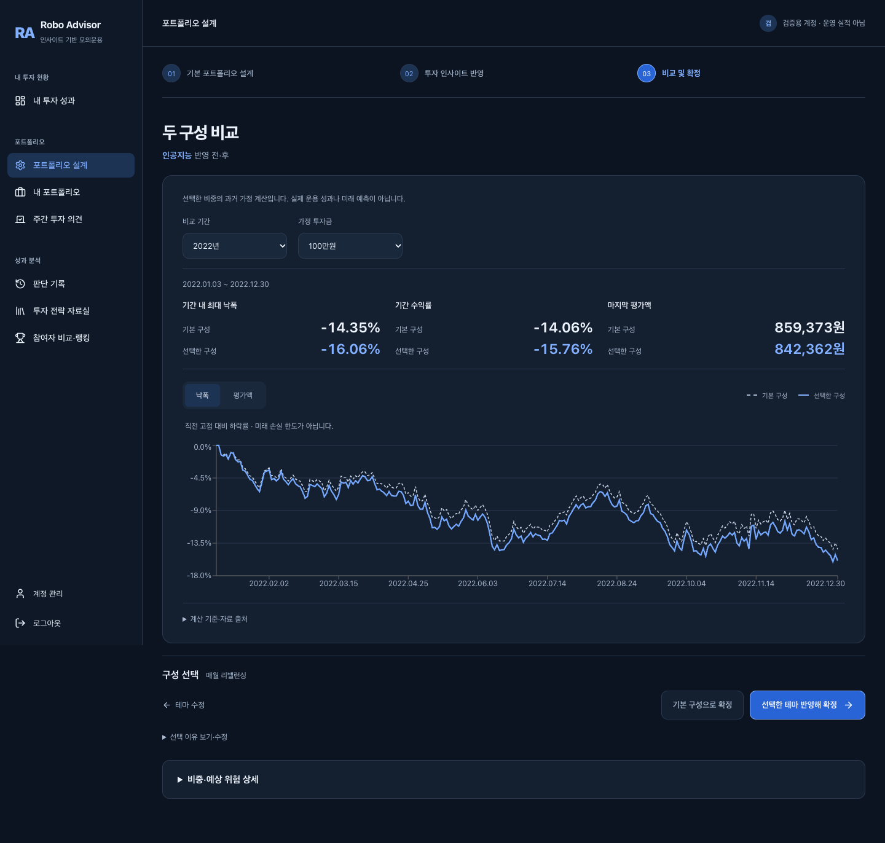
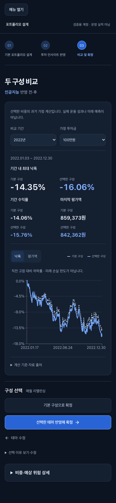

# 확정 전 같은 조건의 과거 비교

## 목적과 완료 기준

테마를 선택한 사용자가 확정 전에 기본 구성과 선택한 구성의 과거 움직임을
같은 기간·금액으로 비교하고, 어느 구성을 저장할지 직접 고른다.
기존 `포트폴리오 설계 → 투자 인사이트 반영 → 비교 및 확정`의 마지막 단계에
통합한다. 별도 메뉴나 새로운 디자인 체계를 추가하지 않는다.

완료 기준은 두 구성의 명시적 선택, 비교 조회의 무저장성, 원래 판단의 보존,
자료 부족·조회 실패의 구분, 데스크톱/모바일 실제 API 검증이다.
수익 개선이나 투자자의 의사결정 개선을 입증했다는 주장은 범위 밖이다.

## 구현 결정

- 기존 `review.module.css`와 공통 색상·여백·컨트롤 및 PerformanceChart를 사용한다.
  최대 낙폭을 먼저, 수익률과 마지막 평가액을 함께 표시한다. 상세 자산배분·예상 위험은
  펼쳐 볼 수 있도록 남긴다. 기존 확정 후 리허설과 판단 검토 경로도 유지한다.
- 새 인증 API `POST /api/v1/me/onboarding/rehearsal`은 frontier_id, theme_ids,
  period, initial_amount만 받는다. 비중·소유자·기존 판단 ID를 클라이언트가 지정할 수 없다.
- 기존 onboarding preview의 검증·배분 계산을 호출하고, 기존 리허설의 가격·평가
  엔진을 공유한다. 한 응답의 `proposal`로 비중·예상 위험 상세까지 표시해
  화면 안에서 서로 다른 시점에 계산된 배분이 섞이지 않게 한다.
- `decision_id`, `confirmed_at`은 null, `method.allocation`은
  `UNCONFIRMED_PROPOSAL`이다. 원장·판단·초안 저장 없이 조회한다.
- 마지막 버튼만 기존 complete API를 호출한다. 기본 선택은 theme_ids=[],
  테마 선택은 사용자가 고른 테마를 전달한다. 선택 이유는 선택 사항이며
  새 판단에만 저장한다. 기존 리밸런싱 주기를 그대로 전달한다.
- 별도 저장 테이블·인프라·주문 실행 경로를 추가하지 않는다.

## 표시 및 한계

현재 선택을 과거 가격에 적용하는 매수 후 보유 가정이며 실제 운용 실적이나
미래 예측이 아니다. 비용·세금·현금 이자·정기 리밸런싱은 포함하지 않는다.
미국국채·TIPS 환헤지 대용가격과 원화 환산·전처리 제약을 화면에 표시한다.
기간은 자료에서 제공하는 전체/연도이며 유리한 기간을 자동 추천하지 않는다.

자료를 정상 조회했지만 모든 자산의 공통 가격이 없으면 UNAVAILABLE와 사유를
표시한다. 유효한 배분 상세를 확인하고 과거 비교 없이 명시적으로 확정할 수 있다.
통신·입력 검증 실패는 별도 오류/재조회 화면이며 확정을 막는다. 기간 변경 중
이전 숫자를 새 기간의 결과로 남기지 않고, 입력 컨트롤의 키보드 포커스를 보존한다.

preview와 complete는 기존 규약에 따라 서버에서 각각 계산한다. 둘 사이 모델이나
가격 자료가 바뀔 경우 완전한 원자적 스냅샷 보장은 없다. 고정 자료 조건에서
조회·확정 비중의 일치를 검증하며, 장기 세션의 모델 갱신을 원자적으로 묶는
규약이 필요해지면 별도 변경으로 다룬다.

## 검증 재현

운영 DB/계정을 수정하지 않는 격리 검사다. 임시 DB는 `/private/tmp/`에 생성한다.

```sh
.venv/bin/python -m pytest tests --ignore=tests/backup -q
cd web
npm test
npx tsc --noEmit
NEXT_PUBLIC_CAPSTONE_DEMO=1 NEXT_PUBLIC_LAB_MEETING=1 npm run build
cd ..
.venv/bin/python web/e2e/run_rehearsal.py
```

- API: 무저장 반복 조회, 확정 전/후 동일 계산, 인증·임의 비중·중복 테마 거부,
  가격 자료 미확보 시 가짜 실적 미생성.
- UI: 별도 두 확정 동작, 기간 로딩/실패/재시도, 키보드 포커스, 자료 미확보,
  테마 없는 기본 구성, 주기 유지.
- 실제 API 브라우저: 기존 확정 후 리허설/검토 3개와 새 비교·확정 2개.
  조회 전후 기록 수 불변, 선택한 비중과 새 판단 일치, 과거 판단 불변,
  선택 이유·새로고침, 주문/체결/NAV 불변, 390/320px 가로 넘침 검증.

화면 증거는 격리 계정의 UI 검증이다. 운영 수익률 증거가 아니다.




## 실행 결과 (2026-10-26)

SQLite 백엔드 748 통과, PostgreSQL 환경 검사 57 제외. 프런트 146 통과.
타입 검사·production 빌드 통과. 실제 API 브라우저 5개 통과.
390px 및 320px에서 본문과 펼친 상세의 페이지 가로 넘침 없음.
별도 lint 스크립트는 없으며 기존 빌드의 검사와 타입 검사를 사용했다.
의존성 변경은 없고 기존 잠금파일의 설치를 재사용했다.

## 배포

기존 release/public-operation 브랜치와 기존 Vercel/Render 서비스에 반영한다.
새 API가 있으므로 프런트와 백엔드 모두 배포해야 한다. 스키마 변경은 없다.
운영 확인은 로그인한 계정의 비교 조회까지만 수행하고, 투자 구성을 임의로 확정하지 않는다.

AI가 기존 코드 조사·구현·테스트 및 문서 작성을 수행했다. 실제 실행 결과와
화면 확인을 검증 근거로 사용하며 제품 매력·수익 성과는 별도 검증 대상이다.

## 2026-10-26 — 정보 위계 정리

중복 영문/질문형 제목과 설계 안내 배너를 비교 단계에서 제거했다. 기간과 금액은
한 번만 지정하고, 실제 적용 날짜는 유지하며 관측 개수는 계산 기준에 옮겼다.
과거 가정 계산·실제 성과/미래 예측 구분은 첫 화면에 유지한다. 선택 이유는
기본적으로 접고, 돌아가기는 텍스트 버튼으로 낮췄다. 두 확정 버튼은 함께 배치한다.
계산·API·저장 규약은 변경하지 않았다.

프런트 146개, 실제 API 브라우저 5개, 타입 검사·production 빌드 통과.
기존 브라우저 시나리오에서 이유 펼침→저장→새로고침, 두 확정 경로,
320/390px 본문 및 펼친 상세를 확인했다. 이 문서의 격리 화면을 갱신했다.
