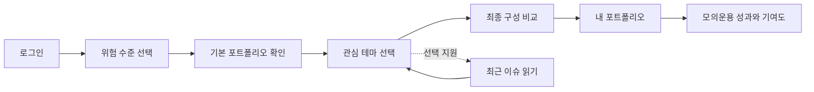
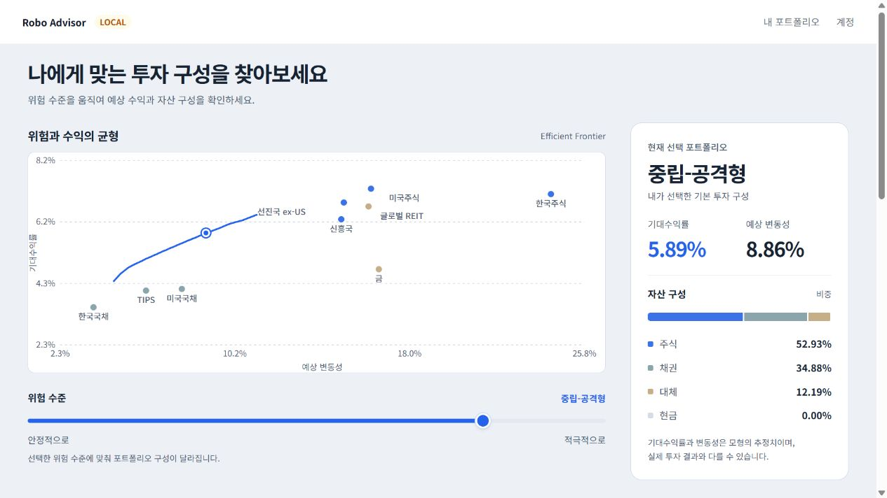
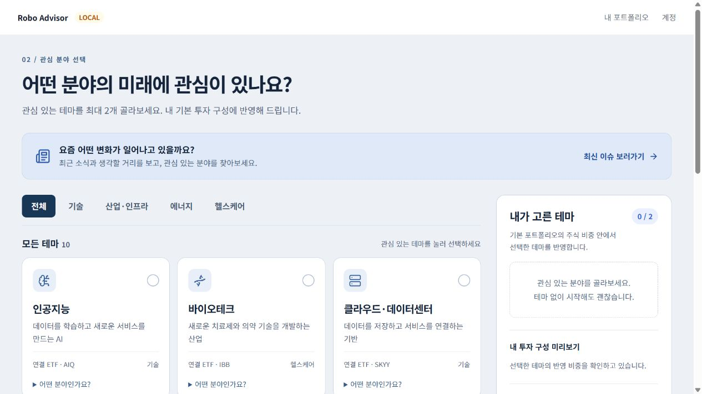
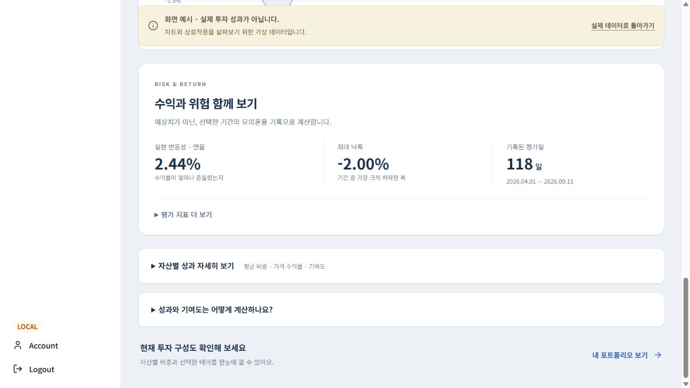

# 제품 가이드

기준일: 2026-09-16
대상: 제품·디자인·프론트엔드·백엔드 개발팀

## 1. 제품이 해결하려는 문제

이 서비스는 사용자에게 하나의 정답 포트폴리오를 강요하지 않습니다. 사용자가 감당할 위험 수준을 먼저 고르고, 기본 자산배분을 확인한 다음, 관심 있는 산업·테마를 제한된 범위에서 반영하도록 돕습니다. 이후 모의운용 데이터를 통해 결과와 위험을 확인합니다.

핵심 문장은 다음과 같습니다.

> 기본 자산배분은 Efficient Frontier에서 고르고, 관심 분야는 주식 비중 안에서 제한적으로 반영하며, 결과는 CORE 벤치마크와 모의운용 성과로 확인한다.

## 2. 핵심 사용자 흐름

## 화면 참고

### 위험 수준 선택

### 관심 테마 선택

### 성과와 자산별 기여도

아래 화면의 숫자는 UI 확인용 예시 데이터이며 실제 투자 성과가 아닙니다.

### 2.1 위험 수준 선택

- 첫 화면에서 Efficient Frontier를 크게 보여줍니다.
- 주식·채권·대체자산은 서로 다른 색을 사용합니다.
- 개별 자산 점에는 자산명을 항상 표시합니다.
- 자산에 마우스를 올리거나 키보드로 포커스하면 해당 자산 바로 아래에서 기대수익률과 변동성을 확인합니다.
- 슬라이더로 위험 수준을 바꾸면 기대수익률, 예상 변동성, 자산군 비중과 상세 자산 구성이 함께 갱신됩니다.
- 아래의 원형 차트와 자산 목록은 서로 연결되어 같은 자산을 강조합니다.

사용자가 이 단계에서 답해야 하는 질문은 “수익 가능성과 가격 변동 중 어느 수준이 나에게 맞는가?”입니다.

### 2.2 관심 테마 선택

- 테마를 기술, 산업·인프라, 에너지, 헬스케어 등 카테고리로 탐색합니다.
- 카드에는 한국어 테마명, ETF 티커, 한 문장 설명, 반영 예상 비중을 표시합니다.
- 최대 2개 테마를 선택합니다.
- 총 테마 비중은 최대 15%, 단일 테마는 최대 10%입니다.
- 테마는 채권이나 대체자산을 줄이지 않고 기본 포트폴리오의 주식 비중 안에서 조달합니다.
- “최신 이슈 보러가기”는 테마 선택을 돕는 별도 읽을거리 화면입니다. 현재는 실시간 뉴스 피드가 아니라 직접 선별한 자료입니다.

사용자가 이 단계에서 답해야 하는 질문은 “내가 장기적으로 관심을 두고 싶은 변화는 무엇인가?”입니다.

### 2.3 최종 확인

- Base + Theme Tilt = Personalized 관계를 한눈에 설명합니다.
- 기본 포트폴리오와 개인화 포트폴리오의 자산 구성 변화를 비교합니다.
- 테마 비중이 어디에서 조달됐는지 보여줍니다.
- 같은 위험모형으로 계산한 개인화 전후 변동성 차이를 표시합니다.
- 상세 표는 보조 정보이므로 기본적으로 접어 두고, 사용자가 원할 때 펼칩니다.

사용자가 이 단계에서 답해야 하는 질문은 “관심 테마를 반영한 뒤에도 내가 선택한 위험 수준이 유지되는가?”입니다.

### 2.4 내 포트폴리오

- 현재 자산별 비중과 테마 비중을 원형 차트와 목록으로 보여줍니다.
- 선택한 테마의 이름, ETF, 설명, 실제 반영 비중을 표시합니다.
- 기본 구성과 개인화 구성을 자산군 막대로 비교합니다.
- “구성 변경”을 통해 위험 수준 선택부터 다시 시작할 수 있습니다.

### 2.5 투자 현황

- 내 누적수익률과 CORE 벤치마크 누적수익률을 같은 기간으로 비교합니다.
- 두 수익률의 차이와 최대낙폭을 핵심 지표로 표시합니다.
- 누적 기여도 차트는 어떤 자산이 전체 성과를 만들었는지 보여줍니다.
- 그룹별/자산별 전환, 기여도 순위, 선택 자산 강조를 제공합니다.
- 실제 모의운용 데이터가 없으면 빈 상태를 보여주고, 명확히 표시된 예시 데이터로 화면을 살펴볼 수 있습니다.

## 3. 화면 설계 원칙

1. 한 화면에는 하나의 핵심 질문을 둡니다.
2. 계산식보다 사용자가 선택한 결과를 먼저 보여줍니다.
3. 영어 내부 ID 대신 한국어 자산명과 설명을 사용합니다.
4. 데이터가 없으면 0처럼 보이게 만들지 않고 “아직 데이터가 없음”으로 표시합니다.
5. 실제 데이터와 예시 데이터는 색상과 배너로 분명히 구분합니다.
6. 기대수익률은 전망이 아니라 모델 가정이라는 설명을 유지합니다.
7. CORE 벤치마크와 사용자가 고른 Base 포트폴리오는 서로 다른 개념으로 표시합니다.

## 4. 용어

| 용어 | 의미 |
|---|---|
| CORE | 운영 기준이 되는 고정 벤치마크 `CORE_V0.3` |
| Base Portfolio | 사용자가 Efficient Frontier에서 선택한 기본 자산배분 |
| Theme Tilt | 사용자가 고른 테마를 주식 비중 안에서 추가한 부분 |
| Personalized | Base Portfolio에 Theme Tilt를 반영한 최종 구성 |
| Tracking Error | 비교 기준과 개인화 포트폴리오의 수익률 차이 변동성 |
| Active Theme Weight | 최종 포트폴리오에서 테마가 차지하는 비중 |
| 기여도 | 거래 현금흐름을 제외하고 각 자산 손익이 포트폴리오 수익률에 기여한 정도 |

## 5. 제품 범위 밖

- 실제 증권계좌 연결과 주문 실행
- 투자 적합성 심사나 규제상 투자 권유
- 세금, 실제 체결 미끄러짐, 환헤지 비용의 완전한 반영
- 실시간 뉴스 수집과 자동 테마 추천
- 미래 수익률 보장 또는 매수·매도 신호
