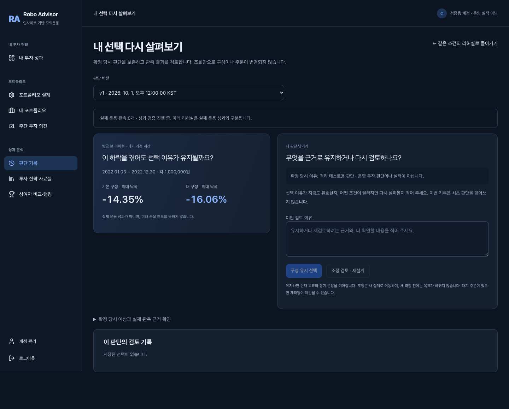

# 리허설에서 검토 기록까지

## 확인한 문제

2026-10-26 KST 로그인된 운영 화면에서 리허설 → 검토를 직접 따라갔다. 리허설의 비교 기간·금액이 검토 화면에 전달되지 않았고, 관측 미확보의 상세 설명과 비중 표 아래에 이유 입력란이 있었다. 이유 초안은 부모 상태에 남아 판단 버전을 바꿔도 분리되지 않았다.

대상은 저장된 ETF 구성을 기본 구성과 비교하고 자신의 선택 이유를 재검토하는 사용자다. 이번 완료 조건은 **같은 판단·기간·금액을 보며 검토 이유 저장 → 저장 기록 재조회 → 같은 리허설 복귀**를 수행하고 최초 판단과 운용 원장을 보존하는 것이다. 새로운 전략·판단 추천·금융 계산·DB 스키마는 추가하지 않는다.

## 구현과 결정

- 내부 링크에 판단 ID, 기간, 허용된 투자금, 리허설 출처를 전달한다. 복귀와 새로고침에도 같은 조건을 복원한다. 외부 반환 URL을 받지 않는다.
- 검토 화면에 같은 서버 리허설 응답의 기간·금액·두 구성 최대 낙폭을 표시한다. 과거 가정 계산과 실제 운용 관측을 구분한다. 자료 오류는 수치 대신 조회 실패로 표시한다.
- 리허설 경로에서는 비교 결과 옆에 원래 이유와 이번 검토 입력을 배치한다. 최초 예상·실제 관측의 전체 근거는 펼쳐서 확인한다. 직접 검토 화면을 방문하면 기존 근거를 기본으로 펼친다.
- 기존 KEEP/ADJUST API와 중복 방지 키를 사용한다. KEEP은 기존 목표 유지, ADJUST는 기존 재설계 화면 연결이다. 선택만으로 새 목표를 확정하지 않는다.
- 입력·저장 상태를 판단 ID별 컴포넌트로 분리한다. 버전을 바꾸면 초안과 성공 안내가 섞이지 않는다. 이전 화면의 늦은 ADJUST 응답이 현재 화면을 이동시키지 않는다.
- 저장 성공 안내에 포커스를 옮기고 같은 조건의 리허설 링크를 제공한다. 과거 판단의 이유는 수정하지 않는다.

의도적인 절충: 이번 검토 이유는 기존 자유 입력 기록으로 저장한다. 리허설 조건을 새로운 투자 판단이나 운용 근거 스냅샷으로 자동 저장하지 않는다. 조건은 화면 이동에서만 보존한다. 이후 이 조건 자체의 감사 이력이 필요하다는 요구가 확인되면 별도 계약을 설계한다.

## 검증

- 프런트 141개: 조건 전달, 자료 오류/재시도, 초안 분리, 저장 중복 방지, 저장 포커스, 활성/이전 판단의 조정 응답 처리.
- 기존 API 테스트 27개: 판단·선택 계약과 리허설 계산.
- 실제 FastAPI + 격리 SQLite + production Next.js 브라우저 3개: 조회 경로, 실패/재시도, 이유 저장·재조회·같은 비교로 복귀. KEEP 후 `portfolio_choices`만 1건 늘고 판단·주문·체결·NAV·scheduled_jobs 수는 그대로이며 최초 판단 JSON도 동일함을 대조한다.
- 타입 검사 및 production 빌드. 독립 lint 명령은 이 저장소에 없다.
- 운영 계정에는 검토 이유를 시험 저장하지 않는다. 화면 증거는 격리 검증 계정이다.

재현: `npm --prefix web test`, `DATABASE_URL='' CAPSTONE_DESIGN_DATABASE_URL='' DATABASE_BACKEND=sqlite APP_PROFILE=validation .venv/bin/python -m pytest tests/api/test_decisions.py tests/api/test_investment_rehearsal.py -q`; 웹 production 빌드 후 `.venv/bin/python web/e2e/run_rehearsal.py`.

[모바일 검토 화면](evidence/rehearsal-review-flow/review-mobile.png)

## 자동 운용 확인과 한계

2026-10-26 새벽 확인: `FORWARD_EXECUTOR=actions`, 일별 평가와 모의 리밸런싱 활성화. [직전 일일 실행](https://github.com/MinchoLover/robo/actions/runs/40196521445)은 25일의 `AWAITING_T0`, READY 15/15, 주문·체결·NAV 없음이었다. 공개 API readiness는 `ready`, `forward_test_status=not_started`였다. 오늘 17:17 KST 정기 평가 전이며 이 확인은 오늘의 NAV 적립 성공 증거가 아니다. GitHub 예약은 지연될 수 있다.

기존 26일 20:30 KST 읽기 점검 예약이 ACTIVE임을 확인했다. 시작일·스케줄·보유자산·운영 DB는 이번 수정으로 변경하지 않았다. 실제 사용자 이해도·반복 사용·유료 가치는 아직 검증하지 않았다.
