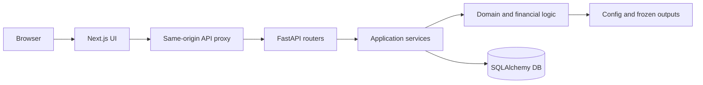

# 기술 인수인계

기준일: 2026-09-16

## 1. 기술 구성

| 영역 | 기술 | 위치 |
|---|---|---|
| 웹 | Next.js 15 App Router, React 18, TypeScript, Tailwind, CSS Modules | `web/` |
| 차트 | Recharts + Efficient Frontier용 커스텀 SVG | `web/app/(app)/` |
| API | FastAPI | `src/api/` |
| 데이터 계층 | SQLAlchemy 2.x, SQLite 로컬 운영, PostgreSQL 이관 구조 | `src/db/`, `migrations/` |
| 금융 모델 | NumPy, Pandas, SciPy, scikit-learn | `src/portfolio/`, `src/risk/`, `src/expected_return/` |
| 모의운용 | 포트폴리오, 주문, 평가액, 성과, 기여도 계산 | `src/forward/` |
| 설정 | 자산, 테마, 최적화, 기대수익률 | `config/` |
| 재현 데이터 | 고정 입력 스냅샷과 모델 산출물 | `data/snapshots/`, `outputs/frozen/` |

브라우저는 Next.js의 `/api/v1/*` 프록시에 요청합니다. Next.js는 세션 쿠키와 CSRF 헤더를 유지한 채 FastAPI로 전달합니다. 금융 계산은 프론트엔드에서 다시 구현하지 않습니다.



## 2. 새 환경에서 실행

### 2.1 요구사항

- Python 3.10 이상
- Node.js 20.19 이상 또는 22.12 이상과 npm
- 로컬 실행은 SQLite로 충분
- PostgreSQL 통합 테스트와 배포는 별도 DB 필요

### 2.2 설치

```powershell
git clone <repository-url>
cd robo-advisor

Copy-Item .env.local.example .env.local
Copy-Item web\.env.example web\.env.local

python -m venv .venv
.\.venv\Scripts\Activate.ps1
python -m pip install --upgrade pip
python -m pip install -r requirements.txt

cd web
npm ci
cd ..
```

### 2.3 실행

한 번에 실행:

```powershell
python scripts\start_local.py
```

Windows 전용 실행:

```powershell
.\scripts\start_local.ps1
```

수동 실행:

```powershell
$env:APP_PROFILE = "local"
$env:DATABASE_BACKEND = "sqlite"
python -m src.local.init
python -m uvicorn src.api.main:app --host 127.0.0.1 --port 8000
```

다른 터미널:

```powershell
cd web
$env:NEXT_PUBLIC_APP_PROFILE = "local"
$env:FASTAPI_INTERNAL_URL = "http://127.0.0.1:8000"
npm run dev
```

접속 주소:

- 웹: `http://localhost:3000/login`
- API 상태: `http://127.0.0.1:8000/health`
- OpenAPI: `http://127.0.0.1:8000/docs`

백엔드는 루트의 `.env`와 `.env.local`을 읽고, 프론트엔드는
`web/.env.local`을 읽습니다. 운영체제나 실행 명령에서 직접 지정한 환경변수가
파일보다 우선합니다. 로컬 계정은 루트 `.env.local`의 `LOCAL_TEST_*` 값으로
생성할 수 있습니다. `.env.local.example`을 복사해 사용하고 실제 운영 비밀번호를
Git에 올리지 마세요. 저장소에 포함된 예시 로그인 정보는 개발자 개인의 로컬
SQLite 미리보기에서만 사용합니다.

## 3. 주요 코드 위치

| 기능 | 프론트엔드 | 백엔드 |
|---|---|---|
| 위험 수준·Frontier | `web/app/(app)/setup/portfolio/page.tsx`, `FrontierChart.tsx` | `src/api/services/frontier_service.py`, `src/portfolio/frontier.py` |
| 테마 선택 | `ThemeSelection.tsx`, `theme-content.ts` | `src/api/routers/themes.py`, `src/forward/themes.py` |
| 개인화 미리보기·확정 | `ReviewStep.tsx`, `review-data.ts` | `src/api/services/onboarding_service.py` |
| 내 포트폴리오 | `web/app/(app)/portfolio/page.tsx` | `src/api/services/portfolio_service.py` |
| 투자 현황·기여도 | `web/app/(app)/dashboard/` | `src/api/services/performance_report_service.py`, `src/forward/performance_report.py` |
| 인증·세션 | `web/app/(auth)/`, `web/lib/api/client.ts` | `src/api/services/auth_service.py`, `src/db/models/session.py` |
| DB 모델·마이그레이션 | — | `src/db/models/`, `migrations/versions/` |

## 4. 핵심 API

모든 사용자 API는 로그인 세션이 필요합니다. 변경 요청에는 CSRF 검사가 적용됩니다.

| 목적 | 메서드와 경로 |
|---|---|
| 현재 사용자 | `GET /api/v1/auth/me` |
| Frontier | `GET /api/v1/me/frontier` |
| 온보딩 임시 저장 | `GET/PUT /api/v1/me/onboarding/draft` |
| 개인화 미리보기 | `POST /api/v1/me/onboarding/preview` |
| 구성 확정 | `POST /api/v1/me/onboarding/complete` |
| 테마 목록 | `GET /api/v1/themes` |
| 포트폴리오 요약 | `GET /api/v1/me/portfolio/summary` |
| 기간별 성과·기여도 | `GET /api/v1/me/performance/dashboard?period=ALL` |
| 현재 View | `GET /api/v1/me/views/current` |

전체 계약은 실행 중 `/docs` 또는 `docs/API_V1.md`를 참고하세요.

## 5. 계산 경계

### 5.1 기본 포트폴리오

- 장기 기대수익률은 `config/expected_returns_v0.yaml`의 전략적 가정입니다.
- 위험은 5년 주간 수익률 Ledoit-Wolf 공분산을 기본으로 사용합니다.
- Efficient Frontier의 각 점은 사전에 계산된 포트폴리오입니다.
- `CORE_V0.3`은 운영 벤치마크이며, 사용자가 고른 Base 포트폴리오와 동일하지 않을 수 있습니다.

### 5.2 테마 개인화

- 최대 2개 테마, 총 15%, 단일 10% 제한입니다.
- 테마 자금은 Base 포트폴리오의 주식 비중에서 비례 조달합니다.
- 개인화 변동성이 Base 변동성보다 1%p 넘지 않도록 테마 비중을 축소할 수 있습니다.
- 최종 화면의 전후 변동성은 같은 공분산 모형으로 비교해야 합니다.

### 5.3 성과와 기여도

- 기간 수익률은 선택 기간의 첫 유효 NAV를 기준으로 다시 계산합니다.
- 자산별 구간 손익은 `기말 평가액 - 기초 평가액 - 순매수 거래금액`입니다.
- 거래비용은 별도 음의 기여도로 표시합니다.
- NAV 변화와 설명 가능한 자산 손익의 차이는 `unexplained`로 남깁니다.
- 스냅샷 합계가 NAV와 맞지 않는 구간은 임의 배분하지 않고 `unexplained`로 처리합니다.
- 연환산 변동성, Tracking Error, Information Ratio는 최소 30개 수익률 관측치가 있을 때만 제공합니다.
- 무위험수익률 기준이 연결되지 않아 Sharpe Ratio는 현재 제공하지 않습니다.

## 6. 데이터와 보안

저장소에 포함할 수 있는 항목:

- 소스 코드, 마이그레이션, 테스트
- 샘플 환경변수 파일
- 재현에 필요한 고정 모델 설정과 입력 스냅샷
- 개인을 식별하지 않는 정적 모델 산출물

저장소에 포함하면 안 되는 항목:

- `.env`, `.env.local`과 실제 비밀번호·API 키
- `data/*.db`, 세션, 사용자·참가자 데이터
- `data/archive/`의 운영 백업
- `.work/`, Next.js 빌드, 테스트 리포트, 로그

SQLite DB가 없어도 `python -m src.local.init`으로 로컬 DB를 생성할 수 있어야 합니다. 개발팀 전달 전 항상 새 디렉터리에서 이 경로를 검증하세요.

## 7. 검증 명령

```powershell
python -m pytest tests -q

cd web
npm test
npm run build
npx tsc --noEmit
npm audit --audit-level=low
```

PostgreSQL 통합 테스트는 `TEST_DATABASE_URL`이 없으면 건너뜁니다. Playwright E2E는 로컬 API와 테스트용 DB를 준비한 뒤 `npm run test:e2e`로 실행합니다.

`next build`와 `tsc`를 동시에 실행하면 두 프로세스가 `.next/types`를 함께 갱신해 파일 없음 오류가 날 수 있으므로 순서대로 실행하세요.

2026-09-16 전달본은 Next.js 15.5.24, Vitest 4.1.11, Vite 7.3.6을 사용하며 `npm audit` 0건을 확인했습니다. `postcss`는 Next.js의 고정 하위 버전 대신 보안 수정 버전 8.5.28을 사용하도록 `overrides`에 명시했습니다.
